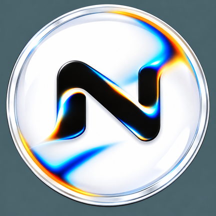

<p align="center">
  
</p>

<h1 align="center">NXYMusic</h1>

<p align="center">An independent, community-maintained music app for Android, built with Compose Multiplatform.</p>

<p align="center">
  <a href="https://github.com/revhuyrr/nxymuisc/releases/latest">Latest APK release</a>
  ·
  <a href="https://github.com/revhuyrr/nxymuisc/releases">All releases</a>
</p>

NXYMusic provides music discovery, playback, playlist and library tools, synchronized lyrics, offline features, and integrations with third-party music services. Features can change as those services change.

## Download and update

Download the signed APK from [NXYMusic Releases](https://github.com/revhuyrr/nxymuisc/releases/latest). If NXYMusic is already installed, open the APK and choose **Update**; do not uninstall first, because uninstalling can remove the app's data.

The Android application ID remains `com.nxymusic` for compatibility with existing NXYMusic installations. Releases are signed with the same persistent signing key so Android can install them as updates. Do not change either the application ID or release signing key.

## Features

- Music search, browsing, playback, and personal library/playlist management.
- Lyrics from configured third-party providers, with synchronization and translation features.
- Offline playback, downloads, caching, and playback controls.
- Optional account-based features and integrations such as Android Auto.

Availability and behavior depend on third-party services and device support. NXYMusic is not affiliated with Google, YouTube, YouTube Music, or the original project maintainers.

## Build

The Android app uses Gradle and requires JDK 21 and the Android SDK. To assemble the Android release variant locally:

```bash
./gradlew :androidApp:assembleRelease --no-daemon
```

The repository's **Build NXYMusic APK** GitHub Actions workflow produces the signed release APK. Use the workflow's signed release asset for distribution and updates.

## Support and contact

For questions about NXYMusic or its maintained changes, contact:

- Telegram: [@Heavensreport](https://t.me/Heavensreport)
- Instagram: [@fallendivinesent](https://www.instagram.com/fallendivinesent/)
- GitHub: [@revhuyrr](https://github.com/revhuyrr)

## License and fork attribution

NXYMusic is a modified fork of the open-source SimpMusic project and includes code and dependencies from other projects. It is distributed under the GNU General Public License, version 3.0 (GPL-3.0). The upstream project’s copyright notices and the required third-party license notices are retained; copyright in upstream code remains with its respective holders. NXYMusic-specific changes and branding are maintained in this repository. See [`LICENSE`](LICENSE) and the in-app **Description and licenses** section.

## Legal disclaimer and terms of use

NXYMusic is an independent, community-maintained music app. It is not an official product of Google, YouTube, or YouTube Music, and is not affiliated with those services or with the original project maintainers. NXYMusic is provided under GPL-3.0; consult the license and retained copyright notices for the terms that apply to the software.

The app may connect to YouTube, YouTube Music, and other third-party services. Those services and their content are operated and owned by their respective providers and rights holders. NXYMusic does not operate a media-hosting service; depending on your choices and settings, data or media may be cached or downloaded to your own device. Availability, content, and service behavior can change without notice.

You are responsible for using the app in accordance with applicable laws, copyright rules, and the terms of the services you access. Use authorized content and respect artists, creators, and rights holders. The maintainers cannot grant rights to third-party content or resolve claims about material controlled by other services.

The software is provided **“AS IS”**, without warranties or guarantees of any kind, to the extent permitted by applicable law. For questions or concerns specific to NXYMusic, contact **@Heavensreport** on [Telegram](https://t.me/Heavensreport) or **@fallendivinesent** on [Instagram](https://www.instagram.com/fallendivinesent/). For a third-party content or copyright claim, contact the relevant rights holder or service provider.
